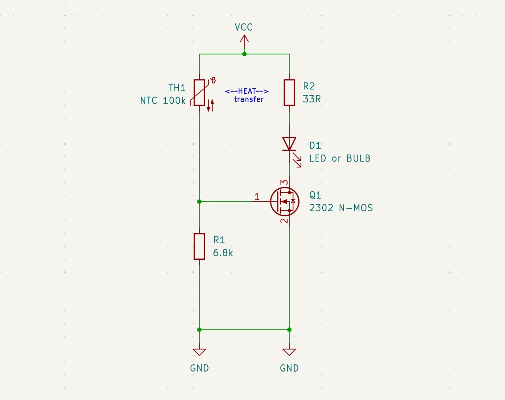

# skeuomorphicer_candle
A more skeuomorphic LED candle, one that you turn on with a flame, and off with a blow, like a real candle!
Super simple design with no microcontrollers nor op-amps. Just one transistor, one thermistor and a couple of passives.

# How it works

* Heating the NTC thermistor makes its resistance drop, which increases the voltage on the MOSFET gate and turns on the bulb
* The current limiting R2 resistor gets hot
* The PCB is carefully designed to thermally connect R2 to the NTC
* Heat from R2 makes the NTC hot, so it stays hot even when the flame is removed
* This keeps the candle on
* Once you blow on the PCB, the heat is removed, breaking the cycle and turning off the light
* Yes, the schematic looks like a candle

* The current limiting (and heat producing) resistor is doubled, to surround the NTC on both sides
* They also share an electrical connection with the NTC - the VCC node (on top)
* That VCC copper connection is used to transfer heat from the resistors to the NTC
* But also, is wide and exposed to being blown at
* This is a finicky design challenge that required iterative tine tuning
* The current implementation works best with about 0.1W (total) dissipated on the heating resistors, which keeps the NTC at about 55°C
* Testd on a 1.0mm 2-layer PCB with 35um copper foil. Tested with black solder mask (it might make a difference?)

Note that this is the simplified schematic. In real application, the varying voltage of batteries causes the circuit to be unreliable. With a full battery, the NTC runs too hot, making the candle difficult to blow out, and with a low battery it runs too cool, turning itself off unprompted. To fix this, the recommended design adds a voltage regulator (boost converter) to keep VCC stable and the candle reliable.
