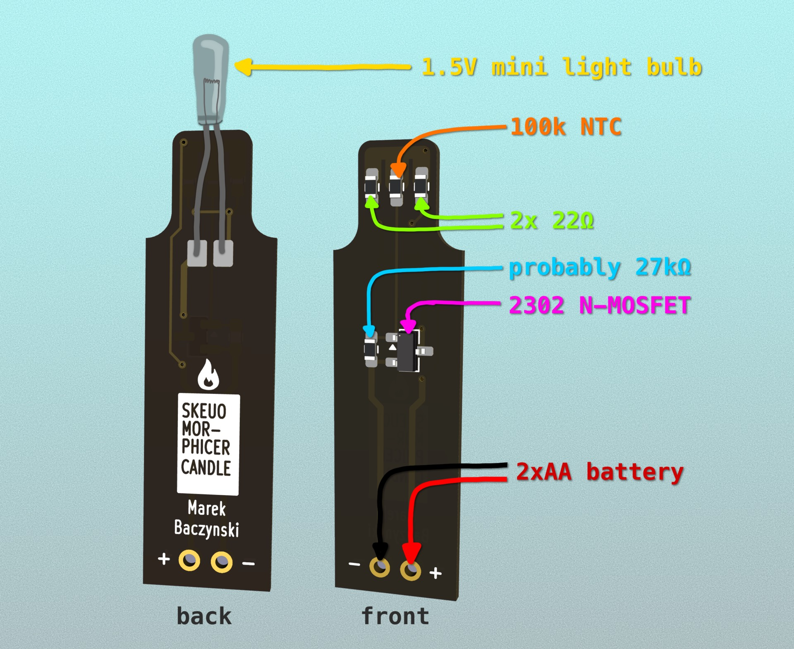

# Minimal Skeuomorphicer Candle
Wokrs OK, not great, but uses very few parts

# Assembly instructions

* Populate all components as shown
* Supply from 2xAA batteries (NiMH rechargable preferably)
* Test if behaves well
* If does not stay on, increase R1 (27k)
* If difficult to blow out, reduce R1 (27k)

# Sensitive to battery voltage
* This design is sensitive to battery voltage
* The lower the voltage, the more likely the candle will turn itself off
* Therefore, the candle will likely turn itself off even then there is plenty of energy left in the battery
* That is why it is best to use NiMH rechargables, otherwise you will be left with a buch of half-full batteries
* The other designs use a voltage regulator to avoid this issue

# Design relies of Vgs(th)
* This design relies on the threshold voltage of an NMOS, which is not good practice
* Be prepared to need to adjust R1 depending on your exact transistor
* It might even be necessary to tune for each transistor from the same batch
* Not a great design!

# Part list
* 1x 1.5V miniature tungsten bulb. 3mm or 4mm size, should draw about 130-160mA at 1.5V
* 1x SI2302 N-MOS (or similar. Vgs(th) should be about 0.7V)
* 1x 100k NTC thermistor in 0603 package
* 2x 22R resistors in 0603 package
* 1x 27k resistor in 0603 package
* 1x battery holder for 2xAA
* 2x AA battery (NiMH rechargable works great)

